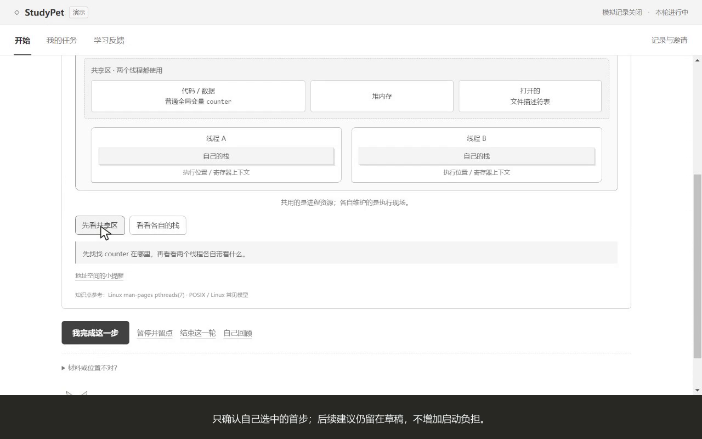

# StudyPet

StudyPet 是一个面向电脑学习的桌面宠物低保真原型：帮助用户把模糊的学习意向拆成眼前的一小步，暂停后找回学习位置，再根据过程线索写下自己的理解。任务、完成状态和下一步都由用户决定。

当前演示以操作系统的具体知识点为例：**同一进程中的线程共享哪些资源，哪些资源各自独立**。包含双线程图解和两道资源分类自测。

[下载 Windows 演示包](https://github.com/xianyuchen2077/StudyPet/releases) · [简短指南](docs/guide.md) · [观看／下载演示视频（约3分23秒）](docs/demo/StudyPet_OS_Demo.mp4)



## 三条主要流程

- **零负担启动：** 从一句模糊意向开始，按需澄清、改写或再拆小，只确认眼前首步；其余建议仍留在草稿。
- **切换后恢复：** 主动暂停并留点，核对或修正材料位置，再接着原来的一轮学习。自测可以恢复到具体题目。
- **阶段检查与复盘：** 查看来源明确的过程线索，自己解释、写回顾；整理候选可以拒绝或修改，下一步需另行确认加入计划。

任务与小步支持用户选择、排序、暂放、明确完成和撤回。模拟记录与主动邀请分别控制，默认关闭；保存失败保留输入，编辑草稿可暂存后继续。

## 运行

Windows 试玩可从 [Releases](https://github.com/xianyuchen2077/StudyPet/releases) 下载并解压完整目录包，运行其中的 `StudyPet.exe`，无需配置 API。请保留同目录的 `resources` 等文件。

从源码运行，先安装 Node.js 和 npm，然后执行：

```sh
git clone https://github.com/xianyuchen2077/StudyPet.git
cd StudyPet
npm ci
npm start
```

Windows 安装依赖后，也可双击 `StudyPet.cmd`。双击桌宠打开面板；关闭面板后桌宠保留，右键菜单可退出应用。

```sh
npm run test:study  # 核心行为测试
npm run dev         # 开发模式
npm run build       # Windows 目录构建，输出到 dist
npm run classic     # 保留的上游助手模式
```

当前学习演示在本机 Windows x64、Electron 28.3.3 上进行过走查，37项核心行为测试通过。其他系统、跨电脑、多显示器及长时间使用尚未验证。

## 演示边界

这是用于课程交互设计与试玩的原型。图解和自测是本地教学示例，启动引导和整理建议为预设内容；不会监测真实电脑行为或调用模型。用户自己的文字与系统候选分别呈现，自测答案不会自动变成“已掌握”或“任务已完成”。

默认学习数据保存在当前 Windows 用户的 `%APPDATA%/StudyPet-OS-Demo`，与原助手配置分开。仓库不包含本机学习记录、API密钥、依赖缓存和构建产物。

## 代码与文档

- `study/`：学习状态、保存、权限、邀请和 Electron 窗口协调。
- `renderer/study/`：学习面板、桌宠、图解和自测。
- `test/`：学习状态、窗口、隔离桥与学科情境的行为测试。
- `docs/guide.md`：三个试玩任务与使用边界。
- `docs/demo/`：演示视频；`docs/assets/`：示例截图。
- `docs/technical-design-and-feasibility.md`：早期技术评估，包含历史规划，当前功能以本说明和代码为准。
- `docs/upstream-README.md`：原框架说明。

知识点参考 [Linux man-pages pthreads(7)](https://www.man7.org/linux/man-pages/man7/pthreads.7%40%40man-pages.html)。图解采用典型 POSIX/Linux 模型；每线程各自维护调用栈，不表示彼此处于隔离的地址空间。

## 来源与许可

本项目基于 [JianguSheng/yuns-desktop-pet](https://github.com/JianguSheng/yuns-desktop-pet) 扩展，保留原作者署名及 [MIT 许可证](LICENSE)。新增学习交互与实现使用 Codex 辅助完成，并进行自动化与桌面走查；这些检查不作为真人可用性研究或学习成效证据。
