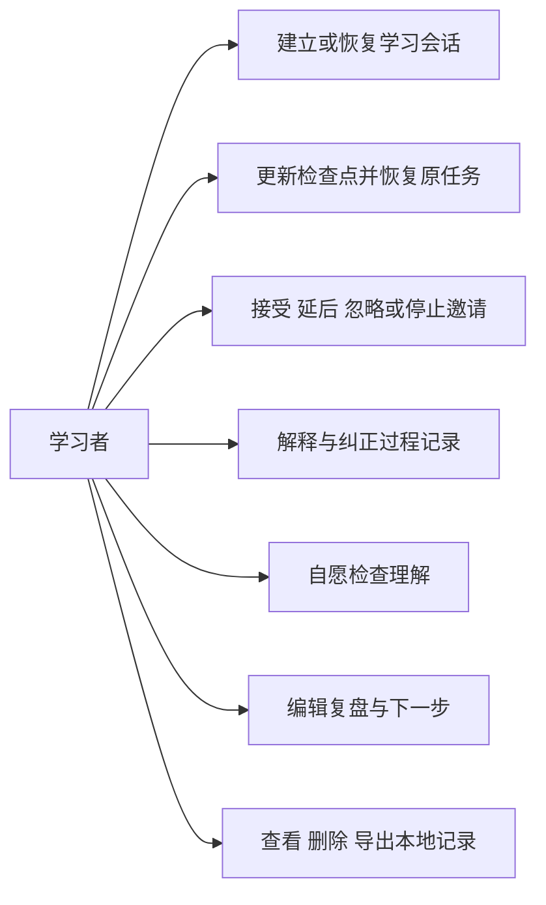
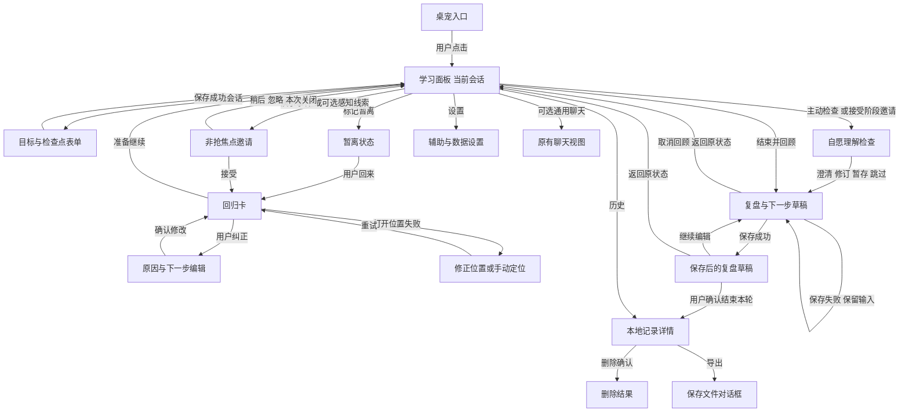
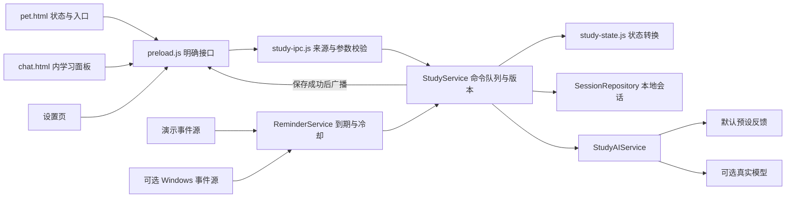
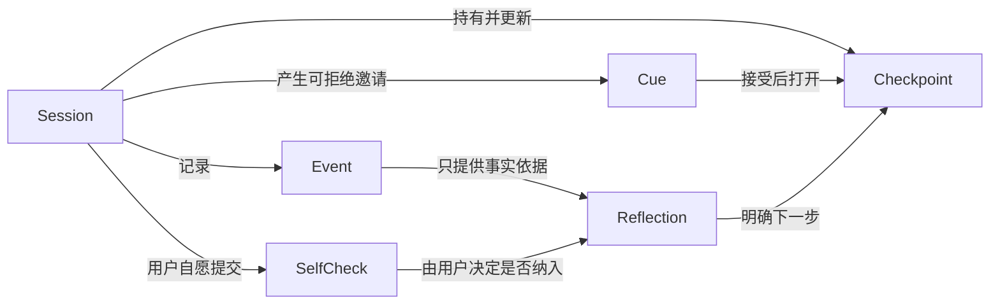

> 历史评估文档：包含早期设计与当时验证范围。当前功能、运行方式和限制以仓库首页与简短指南为准；机器本地路径已改为相对引用，运行结果文件未公开。

# StudyPet 桌面学习伙伴技术设计与可行性评估

日期：2026 年 11 月 12 日
适用团队：A、B 为软件工程同学，C 为美术同学；剩余约三天
源码基线：`JianguSheng/yuns-desktop-pet`，提交 `72c26da4a74e4a15944d3c131a75dc9113329a17`
项目位置：StudyPet（本地研究或历史验证材料，未随源码发布）
文档状态：设计提案与可行性评估。新增学习功能尚未接入产品；本轮完成了依赖安装、基线运行探针、Windows API 探针及目录打包验证。

## 1 结论与三天交付目标

**建议保留现有 Electron 桌宠外壳，把主要开发投入放在“学习目标与进度卡—切换后的任务恢复—自愿检查与复盘”这一闭环。三天内，以本地状态和预设反馈支撑完整交互的版本有条件可行。** 条件是两位开发同学合计能投入约 30 小时、第一天冻结接口，并将真实模型调用、自动读屏和复杂动画放在关键路径之外。工时为规划估计，并非已测得的开发耗时。

当前仓库可以承担窗口、配置、图片展示和 API 调用的基础工作，但它仍是通用聊天助手。增加“你该学习了”的气泡，不能形成你们 P1 中的任务恢复与自主辅助方案。

本轮建议服务一个用户群：**使用电脑连续自学、会在课件、浏览器、笔记与 AI 之间切换的大学生**。群内保留两种差异：有人主要需要找回位置和下一步，有人更需要检查理解与留下疑问；这不是两组新招募的人物研究。P1 中论文整理、设计交付等范围可保留为后续迁移场景。本轮若把它们另列为目标用户群，就必须为每群另做至少两个关键任务分析。

建议交付的两个关键任务：

1. **T1 切换后恢复学习**：找回目标、原材料位置和下一小步；允许说明“这次切换是必要的”、休息或换目标。
2. **T2 阶段检查并留下下一步**：自愿表达理解、标记不确定处，修订回顾，保存下次从哪里继续。

这两个任务对应 P1 最新报告（本地研究或历史验证材料，未随源码发布） 中优先的 O01，以及并行的 O02。桌宠是入口和状态反馈载体；提醒是否合时、是否降低回归负担仍需要用户验证。

### 1.1 实现层级

| 层级 | 本轮内容 | 可行性判断 |
|---|---|---|
| R1 三天核心版本 | 目标与检查点、用户确认的切换原因、回归卡、稍后/忽略/关闭辅助、自愿检查、可编辑复盘、本地保存/删除/导出、标注清楚的演示脚本 | 推荐；基础运行能力已验证，业务功能仍需开发和验收 |
| R2 可选增强 | 自定义形象、旁支疑问独立列表、轻量阶段计时、手动选图后调用真实模型 | 先完成 R1；真实模型需要成员自己的配置与测试 |
| R3 后续研究 | Windows 前台窗口采样、可纠正的候选提醒、有限范围的屏幕理解、长期个性化 | API 层面部分可行；不能据此承诺准确识别分心或三天完成 |

**基础探针通过不等于新增产品已完成。** 当前实测为 10 项基础检查通过、1 项消息编辑一致性检查失败；目录包成功生成，但包内缺少模板文件。第 12 节列出证据与边界。

## 2 现有项目能复用什么

### 2.1 已有能力与接入位置

| 能力 | 源码位置 | 本轮处理 |
|---|---|---|
| 透明宠物窗口、独立聊天与设置窗口 | main.js:57（本地研究或历史验证材料，未随源码发布），`createPetWindow/createChatWindow/createSettingsWindow` | 保留；在聊天窗口中增加“学习”视图，避免再造窗口系统 |
| 主进程与页面通信 | preload.js:4（本地研究或历史验证材料，未随源码发布），`contextBridge` | 增加明确的学习接口；学习面板不直接操作任意存储键 |
| 本地配置存储 | store.js:9（本地研究或历史验证材料，未随源码发布），`electron-store` | 复用已安装依赖，为学习记录使用独立文件 |
| 换图、大小变化、右键与双击入口 | pet.html:288（本地研究或历史验证材料，未随源码发布） | 换成 C 的原创形象；首先提供少量易辨识状态 |
| 通用文本 API 请求 | api-service.js:482（本地研究或历史验证材料，未随源码发布），`sendMessage` | 作为后续适配基础；本轮学习流程默认走本地演示适配器 |
| 手动截图与图片请求构造 | main.js:241（本地研究或历史验证材料，未随源码发布）、api-service.js:199（本地研究或历史验证材料，未随源码发布） | 不直接等同于注意力感知；真实使用前增加来源选择、预览和发送确认 |
| Windows 目录打包 | package.json:49（本地研究或历史验证材料，未随源码发布） | 已验证能打目录包；修正资源清单后再验收分发 |

当前宠物是**静态图片加 CSS 浮动与呼吸效果**，不是完整 Live2D、逐帧动画或可自动理解屏幕的角色。对于 P2，这已经足以充当低保真入口。

### 2.2 需要先处理的确定问题

| 问题 | 已有证据 | 修复路径与验收 |
|---|---|---|
| 编辑消息时丢失正确索引 | `chat.js:178` 先关闭模态框，关闭函数把索引清成 `-1`；V11 已复现历史与可见消息不一致 | 关闭前保存索引；编辑第一轮后，历史、API 上下文和 DOM 同步截断。复盘使用独立表单，不复用“改问题再发给模型”的逻辑 |
| “保存历史”设置没有形成历史恢复 | `settings.js` 保存 `saveHistory`，聊天历史仍只在渲染数组中 | 学习记录单独持久化；产品重启恢复最后一次未完成会话，不能用设置开关代替实现 |
| 设置中的导出路径未实际使用 | 设置写入 `markdownPath`，`main.js:201` 读取的是固定配置 `./conversations` | 学习导出使用保存文件对话框；取消不创建文件，写入失败保留草稿 |
| 宣称的“流式”实际为完整结果后的逐字显示 | 普通请求返回完整结果，`addMessageStreaming` 再逐字播放；停止只修改页面标志 | 本轮明确为演示反馈；如启用真实 AI，补超时、AbortController 和请求编号，不把停止动画当作取消网络请求 |
| 打包缺少内置模板 | 正向文件清单无 `config/**/*`；本轮实际检查 `app.asar`，模板确实不存在 | 加入 `config/**/*` 以及新增业务目录；解包逐项确认，并从打包程序重新检查两条任务 |
| 当前截图自动取第一个屏幕源 | `captureScreen` 使用 `sources[0]`，聊天动作接着提交分析 | 不在 R1 中启用；R2 提供源选择、预览、删除、显式发送；不能把第一个源称为当前学习窗口 |
| API 测试与发送的地址规范化不一致 | 连接测试可能补 `/chat/completions`，实际发送直接使用地址 | 统一 `normalizeEndpoint()`，测试和发送共用；用本机接口分别验证完整 URL 和 `/v1` 输入 |
| 宠物主体的双击层与拖动区域冲突 | 全尺寸 `no-drag` 层覆盖主体；尚未用真实鼠标手势验证 | 划出单独拖动区域与点击区域，或实现明确的拖动阈值；100%/125%/150% 缩放下手工验收 |

另外，现有配置对象包含明文 API Key，且通用存储 IPC 暴露给所有窗口。`safeStorage` 能力探针成功，只说明可以采用该机制，**不代表原项目已经保护了密钥**。R1 不需要真实密钥；启用真实模型前再完成第 11 节的凭据与发送边界。

## 3 需求依据与产品边界

需求编号沿用 P1，证据定位来自最新版报告；未补齐场次的观察材料仍保留原来的限制。

| 需求 | 设计对应 | P1 证据与解释边界 |
|---|---|---|
| N01 理解与进度检验 | 自己解释、预置小问题、不确定标记 | I-A01/I-B02/I-C07/I-D02；S01/S02/S05。完成勾选和 AI 评价不能证明掌握 |
| N02 上下文衔接 | 检查点、材料位置、下一步、回归卡 | I-A03/I-B04；S04；E01/E02。B 的顺利回归是重要对照 |
| N03 自主介入节奏 | 主动唤起、稍后、忽略、本次关闭辅助 | I-B06/I-B09/I-D08/I-D09；S06–S10。提示时机与频率尚未验证 |
| N04 旁支疑问暂存 | 一行暂存、稍后找回、删除 | 主要为 I-B07；现有纸本/平板做法是否不足尚不明确 |
| N05 阶段回顾依据 | 事实与个人解释并列、可修改回顾、下一步 | I-A06/I-C07/I-D06/I-D07；S02/S14、Q14。不能强制写总结 |
| N06 注意力定位与恢复 | 用户解释切换原因，选择继续/休息/换目标 | E01–E03、OBS-L01–L04；I-A04/I-C05/I-D05；S11–S13。应用名、切换次数不等于分心 |

不把以下内容写成已经成立的发现：桌宠优于普通卡片、提示提升成绩、自动监测能准确判断分心、17 份问卷认可每个单项功能、三组电脑记录代表三名独立用户。窗口记录和用户解释是不同数据，必须分开保存。

## 4 应设计与新增的功能

### 4.1 优先需求表

以下条目同时说明“要做什么”和“怎样检查”。Must 是本轮两条任务所必需；Should 可以在闭环稳定后增加；Could 不进入三天承诺。

| ID | 功能或约束 | 类别 | 来源 | 优先级与理由 | 验收条件 |
|---|---|---|---|---|---|
| R01 | 建立学习会话，保存目标、完成依据、当前位置与下一步 | 功能 | N01/N02；I-A03/I-C07 | Must：恢复必须有参照 | 保存后重开内容一致；只有目标和下一步必填；可修改 |
| R02 | 主动标记暂离，返回时打开回归卡 | 功能 | N02/N06；I-B04、E01/E02 | Must：构成 T1 | 同时找回目标、位置、下一步；链接失效可改为手动定位 |
| R03 | 对提醒选择接受、稍后、忽略、本次关闭辅助 | 功能/体验 | N03；S06–S10 | Must：保持控制权 | 忽略的提醒不重复弹出；关闭后不出现主动邀请；稍后时间可见 |
| R04 | 将记录与解释分开，允许纠正切换原因及建议 | 功能/数据 | N03/N06；E01–E03 | Must：避免误判 | 修改“查资料/休息/其他”后保留可追溯修订；不自动标记“不专注” |
| R05 | 自愿表达理解或回答预置问题，标记不确定和跳过 | 功能 | N01；I-C07/I-D02、S01/S05 | Must：构成 T2 | 用户原答不被覆盖；可以跳过；结果不自动变成“已掌握” |
| R06 | 编辑、保存阶段复盘和下次行动 | 功能 | N05；I-D06/I-D07 | Must：闭合 T2 与下次 T1 | 保存/重开一致；失败保留输入；提交成功才显示已保存 |
| R07 | 查看、删除本地会话，选择位置导出 | 功能/数据 | P1 信息边界约束 | Must：控制已有记录 | 删除包含相关解释和复盘；取消导出不落盘；不导出密钥 |
| R08 | 离线脚本完成两个任务与纠错路径，清楚标注模拟 | 功能/交付 | P2 第3–4页 | Must：课堂可复现 | 无 API Key、无外网仍能演示；模拟事件与真实事件可区分 |
| R09 | 旁支疑问独立列表与按任务找回 | 功能 | N04；I-B07 | Should：证据较窄，可先并入复盘疑问栏 | 暂存、重新打开、删除均可用，不要求立刻求助 |
| R10 | 手动选择学习截图，预览后再发给模型 | 功能/数据 | N01/N02及信息边界 | Should：R1可用文字上下文替代 | 可取消；图片不自动落盘；模型不支持视觉时有明确反馈 |
| R11 | Windows 前台窗口元数据适配器 | 技术/情境 | N06、E01/E02 | Could／R3：不计入三天，不能替代相关性判断 | 退出/暂停时停止采集；空句柄不崩溃；仅产生待确认线索 |
| R12 | 真实模型生成追问与复盘候选文本 | 功能 | O02及方案假设 | Could：质量与网络需要另测 | 超时可退回手动填写；用户确认前不改目标、进度或下一步 |
| R13 | 丰富逐帧动画、成长奖励、长期统计 | 体验 | 方案探索，尚无直接效果证据 | Could：不影响两条任务的完成 | 不以奖励或次数替代学习质量判断 |
| U01 | 低打扰、可见反馈、键盘操作 | 可用性 | N03、关键交互点 | Must：避免工具成为新负担 | 单击入口可见当前任务；提示不抢焦点；Tab可遍历；保存本地反馈目标≤500ms，须后测 |
| C01 | Windows、宿舍/教室、多应用学习；课堂可离线 | 使用情境 | P1情境、P2课堂活动 | Must：适配当前团队条件 | 在另一位成员电脑复测；100%/125%/150%缩放可操作 |
| D01 | 有限本地记录、来源标注、明确保留期限 | 数据 | P1信息边界、P2第2页 | Must：支持查看与删除 | 按第8节容量上限执行；过期提示或清理行为明确；不保存第三方聊天正文 |

### 4.2 互补表示与用户故事

需求表之外，再用用户故事和第 14 节的场景验收卡表达需求，满足 P2 的互补表示要求。

- US01（R01）：作为学习者，我想记录这一轮要完成什么和下一步，以便切换后能继续。
- US02（R02）：作为刚结束求助的学习者，我想找回材料位置和未做完的一步，以便不必重建全部上下文。
- US03（R03）：作为不想被中途打断的人，我想忽略、延后或停止邀请，以便自己决定介入时机。
- US04（R04）：作为仍在查资料的人，我想纠正系统的候选解释，以便正常切换不会被误记为分心。
- US05（R05）：作为对理解不确定的人，我想自己解释并标记卡点，以便决定继续还是求助。
- US06（R06）：作为准备结束学习的人，我想修改回顾并留下下一步，以便下次接着做。
- US07（R07）：作为记录的拥有者，我想查看、删除和有选择地导出，以便控制自己的信息。
- US08（R08）：作为课堂体验者，我想在不配置模型的情况下走通任务并看懂模拟标记，以便准确评价交互。
- US09（R09）：作为暂时不想处理旁支问题的人，我想先存一句疑问，之后按任务找回，以便继续当前步骤。
- US10（R10）：作为需要解释材料的人，我想先预览并选择图片再发送，以便只提供必要上下文。
- US11（R11，后续）：作为愿意开启感知的人，我想控制采集并纠正候选解释，以便获得辅助时仍保有决定权。
- US12（R12，后续）：作为希望得到追问的人，我想看到可拒绝和修改的模型建议，以便自己决定下一步。
- US13（R13，探索）：作为希望认出宠物状态的人，我想选择易辨识的形象反馈，以便理解它何时等待我回应。

## 5 两种概念与推荐组合

| 比较点 | 概念 A 用户主动的回归卡 | 概念 B 系统发起的协商式桌宠 |
|---|---|---|
| 触发方式 | 用户标记暂离、点击宠物或主动复盘 | 系统在候选切换或阶段节点发起邀请 |
| T1 的实现 | 用户打开检查点，自己确认并继续 | 宠物先询问是否仍服务目标，再澄清并给下一步 |
| 责任分配 | 用户决定何时需要帮助；系统保留上下文 | 系统判断可能合适的时机；用户纠正、接受或拒绝 |
| 优点 | 容易解释、打扰少、无持续监测依赖 | 有机会覆盖用户忘记回来的情况 |
| 主要风险 | 用户需要想起主动唤起 | 误判、额外打断、数据采集和实现成本 |
| 三天成本 | 主要是本地表单、状态和持久化 | 完整实现还需要感知、阈值、冷却、澄清与评估 |

**推荐以 A 为主，保留 B 的可拒绝邀请和纠错交互；本轮 B 的触发由显式演示按钮注入。** 这使课堂可以体验主动帮助，又不声称自动识别已经实现。拒绝把“持续读屏后自动判断分心”设为默认，是因为现有证据不足且开发与评估成本超出三天关键路径。

仍待验证：用户是否愿意记录检查点、何时愿意回应、一次回归卡是否比找原窗口更省力，以及桌宠是否影响正在进行的工作。两种概念的差异在触发和责任分配，不能只画成两种配色。

## 6 任务分析与界面流程

### 6.1 T1 的现状与设计后层次任务分析

**目标**：必要切换后，找回原材料并继续一项明确的下一步。**触发**：结束求助、检索或消息处理，准备回到学习。**成功反馈**：材料和下一步可见，用户确认开始执行；不以“点击继续”证明已经专注。

现状 HTA：

```text
0 恢复原学习任务
  1 回忆原目标与进度
  2 找到课件、笔记或原窗口
  3 找回求助解释或所需资料
  4 决定下一步
  5 执行下一步
Plan 0：通常1→2→3→4→5；若不需求助解释可跳过3。
        找不到位置时回到1/2重新定位；解释不足时重做3；也可主动休息或调整目标。
```

设计后使用相同方法：

```text
0 借助检查点恢复学习
  1 打开当前会话的回归卡
  2 核对目标、位置、上次进度与下一步
  3 确认或修改切换原因及检查点
  4 打开材料或按定位文字手动返回
  5 确认准备执行，必要时调整下一步
Plan 0：1→2；有错误则3，否则跳到4；4成功后5。
        4失败→修改位置→重试或复制定位文字；全程可选择休息或换目标。
```

关键交互点是检查点是否过时、用户能否纠正解释、材料打不开时是否有替代路径，以及提示是否打断正常求助。外部输入是用户提供的位置与链接，不预设可以访问完整浏览器或 AI 历史。

### 6.2 T2 的现状与设计后任务序列

**目标**：表达理解或未理解处，保存一份可修改的回顾和下一步。**触发**：用户认为内容告一段落，或主动结束本轮。**成功反馈**：原答和修订可见，保存成功后可以重新打开。

现状：学习到节点 → 按个人策略复述/推导/做题/画图 → 判断是否继续查资料 → 按需回看、标记位置或直接结束。P1 已有有效自检和回顾策略，不能把现状画成所有人都没有反思。

设计后：主动进入或接受邀请 → 自己解释/回答预置题 → 标不确定处 → 查看预置提示或原材料 → 修订、暂存或跳过 → 看过程记录并补充解释 → 编辑回顾和下一步 → 保存。保存失败保持草稿并重试；拒绝检查时可只留检查点。

### 6.3 用例与所有主要界面容器



教师和助教关注展示是否真实、是否区分完成和理解；屏幕内容涉及的第三方关注不被采集或分享。他们是本轮利益相关者，不虚构成已经参与测试的直接用户。



现有独立设置窗口可以保留；学习视图放在原聊天窗口中。邀请是桌宠上的轻量状态或小气泡，不因系统事件自动聚焦聊天窗口。AI 请求、预设追问和用户操作都应标明触发主体；上述图中的“演示事件”不得改写成已发生的真实观察。

## 7 总体架构与文件改动

### 7.1 保留技术栈

继续使用 CommonJS、HTML/CSS/普通 JavaScript、Electron 和已安装的 `electron-store`。本轮不增加前端框架、独立后端、数据库服务器或 Rust 工具链。核心规则写成纯函数，原聊天与学习业务分开，避免将新的业务再塞进已有的大文件。



### 7.2 新增文件与责任

以下是**待实现目录**，不是宣称文件已经存在。根目录均为 `.`。

| 待新增路径 | 单一职责 | 负责人 |
|---|---|---|
| `domain/study-state.js` | 纯状态转换、合法动作、版本与业务不变量 | A |
| `data/session-repository.js` | 使用现有存储依赖读写独立会话、列举、删除和容量限制 | A |
| `services/study-service.js` | 串行命令、持久化成功后提交状态、事件广播 | A |
| `services/reminder-service.js` | 到期时间、稍后、冷却、忽略和会话结束清理 | A |
| `services/study-ai-service.js` | 统一预设反馈与可选模型；请求编号和失败回退 | B |
| `ipc/study-ipc.js` | 限定调用方、校验命令、导出与错误映射 | A |
| `renderer/study-panel.js`、`renderer/study-panel.css` | 学习卡、检查点、回顾表单、草稿和错误反馈 | B；C 提供线框 |
| `config/demo-scenarios.json` | 两个主任务与误判纠正、链接失效、保存失败的预置内容 | B；C 整理文案 |
| `tests/study-state.test.js`、`tests/study-service.test.js` | 状态和存储失败/并发等关键行为测试 | A/B |
| `assets/studypet/` | C 的原创形象与少量状态素材 | C |

修改现有文件的范围：

- [main.js](../main.js)：在 `app.whenReady()` 中组装服务、注册学习 IPC、绑定窗口就绪后的路由、退出时停定时器。保留已有窗口工厂。
- [preload.js](../preload.js)：增加 `studyGet/studyDispatch/studyList/studyExport/studyDelete/onStudyChanged`，订阅返回取消函数；页面销毁时解除监听。
- [chat.html](../renderer/chat.html)：增加学习视图和导航，加载独立脚本；原有聊天输入不承担学习状态的存储职责。
- [pet.html](../renderer/pet.html)：显示目标摘要、辅助关闭状态和待回应提示；点击打开学习视图；解决点击与拖动冲突。
- [settings.html](../renderer/settings.html) 与 [settings.js](../renderer/settings.js)：增加辅助偏好、数据查看/清理入口、演示模式标识。
- [package.json](../package.json)：把新增目录和 `config/**/*` 加入打包正向清单；测试采用 Node 内置测试运行器即可。

## 8 对象模型与数据设计

### 8.1 面向用户的对象与操作

| 对象 | 关键属性 | 用户可执行操作 |
|---|---|---|
| 学习会话 Session | 目标、完成依据、开始/结束、状态 | 新建、暂停、继续、结束、删除 |
| 检查点 Checkpoint | 材料定位、当前进度、下一步、更新时间 | 查看、修改、尝试打开、复制定位文字 |
| 过程事件 Event | 发生时间、来源、事实、候选解释、用户确认 | 查看、解释、纠正；删除随会话处理 |
| 邀请 Cue | 触发理由、显示状态、到期/稍后时间 | 接受、延后、忽略、本次关闭 |
| 自检回答 SelfCheck | 原答、修订、疑问、是否跳过 | 回答、修改、暂存、跳过 |
| 阶段复盘 Reflection | 记录摘要、用户解释、收获、不确定、下一步 | 编辑、保存、重开、导出 |



这是对象与操作模型。界面可借用“书签/进度卡”的隐喻，桌宠是帮助找回书签的伙伴；不暗示它能替用户判断是否理解。

### 8.2 会话数据契约

以下类型用于说明字段，实际代码仍可使用 JavaScript，并在主进程进行运行时校验。

```ts
type SessionStatus = 'active' | 'paused' | 'reviewing' | 'completed';
type EventSource = 'user' | 'demo' | 'window';
type Interpretation = 'unconfirmed' | 'task-related' | 'unrelated' | 'break' | 'other';

interface StudySession {
  schemaVersion: 1;
  id: string;                         // 主进程生成的 UUID
  creationRequestId: string;           // 用于建立会话的跨重启去重
  revision: number;                   // 每次成功提交后递增
  goal: string;
  completionEvidence: string;
  status: SessionStatus;
  createdAt: string; updatedAt: string; endedAt: string | null;
  checkpoint: {
    progress: string; nextStep: string;
    locationText: string; resourceUrl: string | null;
    updatedAt: string;
  };
  assist: {
    enabled: boolean; snoozedUntil: string | null;
    lastPromptAt: string | null; proactiveCount: number;
  };
  cues: Array<{
    id: string; triggerEventId: string | null;
    purpose: 'return' | 'reflect'; reason: string;
    source: 'demo' | 'rule';
    status: 'pending' | 'accepted' | 'snoozed' | 'dismissed';
    createdAt: string; dueAt: string | null; respondedAt: string | null;
  }>;
  reviewReturnStatus: 'active' | 'paused' | null;
  events: Array<{
    id: string; seq: number; at: string; source: EventSource;
    kind: string; observation: string;
    interpretation: Interpretation;
    explanation: string; confirmedByUser: boolean;
    revisions: Array<{
      at: string; interpretation: Interpretation;
      explanation: string; by: 'user';
    }>;
  }>;
  selfChecks: Array<{
    id: string; question: string; originalAnswer: string;
    revisedAnswer: string; uncertainty: string; skipped: boolean;
  }>;
  reflection: {
    revision: number; observations: string; userExplanation: string;
    learningNotes: string; openQuestions: string;
    nextStep: string; savedAt: string | null;
  };
  recentRequestIds: string[];           // 内部去重记录，最多50个，不发送给页面
}
```

`observation` 只能记录确实获取到的动作或用户手动标记。`interpretation` 默认未确认；模型生成的解释只是候选，用户确认后才进入复盘。每次用户确认或修改都追加 `revisions`，当前解释是最后一次修订的摘要，原始事实不被覆盖。演示事件保留 `source: 'demo'`，界面与导出都显示“模拟”。邀请 ID、处理结果和到期时间保存在 `cues`，与对应事件在同一会话中持久化；不会因重启忘记某条邀请已经被忽略。

### 8.3 存储、容量与一致性

建议复用 `electron-store@8.2.0`，由 `SessionRepository` 为每个会话使用一个独立文件，统一放在 `app.getPath('userData')/study-sessions/`。会话 ID 仅接受主进程 UUID，文件名不来自自由文本；原 API 配置继续与学习记录隔离。

初始设计上限：目标 120 字、下一步 200 字、定位文字 300 字；每会话最多 500 条语义事件，每条序列化不超过 1 KiB；最多保留 50 个会话，默认保留 30 天。按事件上限粗估约 25 MiB，再加表单文本和存储开销。该容量是设计预算，尚未做极限性能测试。达到上限时提示导出/删除或压缩已确认摘要，不能静默删除用户未保存的内容。

不把每秒轮询结果逐条落盘，只记录去重后的语义变化。R1 不保存截图；可选截图只短暂保存在内存，取消和窗口关闭时释放。原始聊天正文、剪贴板和第三方消息不纳入默认记录。

主进程按会话串行处理命令：校验请求 → 检查去重记录与版本 → 计算候选新状态 → 保存 → 更新内存与广播 → 返回成功。保存失败不广播“已保存”，页面保留草稿。两个窗口提交相同旧版本时，后一个得到 `REVISION_CONFLICT`，刷新最新状态后由用户决定如何合并。重试使用同一 `requestId`；建立会话时先按 `creationRequestId` 查询已有记录，后续命令与状态一起保存最近50个请求 ID。这样不会因进程重启丢掉当前重试的去重依据。页面快照不包含该内部字段。

每个会话包含自己的事件、解释、自检和复盘，删除时一并移除；不保留一份未告知用户的全局事件副本。过期清理在启动时执行，并明确说明导出的独立文件不受应用内删除控制。

## 9 状态机与邀请策略

会话状态与邀请状态分开，否则“暂离但稍后提醒”“正在复盘但关闭辅助”等组合会迅速变得难以维护。

| 命令 | 前置状态 | 结果 |
|---|---|---|
| `session.start` | 无当前会话 | 建立 active，会话 ID 与初始检查点落盘 |
| `session.pause` | active | paused；可选更新检查点，不强迫填写原因 |
| `session.resume` | paused | active；显示当前检查点，不声称已恢复专注 |
| `checkpoint.update` | active/paused/reviewing | 更新位置与下一步，增加版本 |
| `event.explain` | 非 deleted | 更新所指事件的解释，保留来源与事实 |
| `selfcheck.save` | active/reviewing | 保存原答与修订；允许 skipped |
| `reflection.begin` | active/paused | 先保存 reviewReturnStatus，再进入 reviewing |
| `reflection.cancel` | reviewing | 返回 reviewReturnStatus；不丢失已保存的复盘草稿 |
| `reflection.save` | reviewing | 只保存草稿，不自动结束会话 |
| `reflection.revise` | completed | 修订已保存复盘；增加版本，保留原结束时间，不重新开始学习 |
| `session.complete` | reviewing | completed；确认结束时间与下一步 |
| `assist.set` / `cue.respond` | 任一未完成状态 | 只改变辅助或邀请状态；不改变学习成果 |
| `demo.trigger` | 演示模式，active/paused | 注入有模拟来源的事件；普通模式拒绝该动作 |

邀请状态采用 `pending → accepted/snoozed/dismissed`，稍后到期后可回到 pending。同一 `cueId` 被忽略后不再次显示；全会话关闭辅助时，将本会话所有待显示邀请置为 dismissed。稍后提醒使用已持久化的绝对 `dueAt`，并在同一次提交中更新会话级 `snoozedUntil` 以暂缓其他主动邀请，页面切换不能重置时间。程序重启后只恢复尚未过期的稍后记录；已经过期的记录显示在面板待处理区，不集中补弹。`lastPromptAt/proactiveCount` 支撑跨重启的冷却与次数限制；R1 手动演示事件不计入自动提示次数。

候选自动策略仅用于 R3：会话 active、用户开启感知、不在休息/锁屏/挂起、没有正在回应的邀请、没有冷却或稍后，才可以提出候选。可先试 180 秒持续线索、5 分钟冷却、每会话最多 3 次主动邀请；这些数值是可修改的试验参数，没有效果证据。R1 使用演示按钮，无需等待这些时间。

必须维持的不变量：

1. 任何窗口切换都不直接写成“分心”；任何 AI 文本都不直接改变目标、掌握状态或完成进度。
2. 提示不抢焦点；用户没回应不能被视为接受。
3. completed 会话不再生成邀请；暂停/关闭辅助后不继续后台触发。
4. 取消或迟到的模型结果不得覆盖较新版本；检查 `requestId + sessionId + expectedRevision`。
5. 事实、候选解释和用户确认可区分；演示数据始终保留模拟来源。
6. 未保存成功时保留输入；删除失败时仍能看到记录并重试。

## 10 具体实现路径

### 10.1 先修复基线与建立边界

先解决第 2.2 节中影响本轮的部分：明确拖动区，补打包清单，学习数据使用用户目录，把复盘保存独立于聊天历史。消息编辑如继续保留，则先在 `handleEditConfirm()` 中复制索引再关闭模态框：

```js
async function handleEditConfirm() {
  const newContent = editInput.value.trim();
  if (!newContent) {
    showStatus('消息不能为空', 'info');
    return;
  }
  const editedIndex = editingMessageIndex;
  if (editedIndex < 0) return;
  closeEditModal();
  removeMessagesFromIndex(editedIndex);
  userInput.value = newContent;
  await sendMessage(false);
}
```

这是待采用的修复示例，本轮没有将它写入产品源码。修改后必须让 V11 的历史与 DOM 断言同时通过；模型请求失败时也不能丢失用户的新问题。

### 10.2 目标、检查点与回归卡

1. A 建立纯状态模块和独立会话存储；一次命令返回完整新快照，禁止页面分别写多个零散键。
2. B 在学习视图做目标表单：目标、下一步为必填；完成依据、位置为可选，保存后可补。
3. 暂离按钮先展示已有检查点，允许“一键保留”或编辑，再进入 paused。
4. 返回时显示“本轮目标—上次位置—下一步”，提供“继续”“修改”“休息”“换目标”。换目标必须用户确认，并保存原会话检查点。
5. 网页资源仅允许 `https:`/`http:`；本地文件通过文件选择器选取，并单独验证路径后打开。链接失败显示定位文字和修正入口，不自动执行命令、不绕过 Windows 的前台激活限制。

完成标志：两个窗口读取到同一版本；重启后仍能看到检查点；失效位置可被用户修复。

### 10.3 协商式提示与误判纠正

演示入口 `demo.trigger` 注入“求助结束”“阶段节点”“候选偏离”三类带 `source: 'demo'` 的事件。`ReminderService` 只管理邀请生命周期，不输出“注意力分数”。

示例对话是本组拟定的交互脚本：

```text
宠物：要不要看一眼刚才的任务？〔模拟邀请〕
用户：我是在查进程和线程的资料。
宠物：明白，这次切换仍服务于目标。保留这条材料，还是直接回到刚才的位置？
用户：改一下下一步，先比较两者的共享资源。
系统：展示修改后的下一步；用户确认后保存。
```

拒绝、稍后和关闭辅助都是正常结果。选“稍后”只安排邀请，不替用户把会话设成休息；选“休息”才改变会话状态。C 应把这两种含义在文案中区分。

### 10.4 自愿检查与复盘

1. 学习视图提供“检查一下理解”和“结束并留下下一步”两个主动入口。
2. 对演示课件准备 1–2 道预置问题，用户先回答，再看到预置提示或材料定位；提示标明演示，不写“AI 已判定掌握”。
3. 原答、修订和疑问分开保存。跳过时不强制生成一份空洞总结。
4. 复盘上半部分列可核对事件，下半部分让用户写解释、收获、不确定与下一步。预设生成文本只进候选区，不自动覆盖用户字段。
5. 保存按钮在成功返回后显示时间与版本；失败保留草稿，重试沿用同一请求 ID。

保存后的下一步写回同一会话检查点。“保存草稿”调用 `reflection.save`，不会结束本轮；“返回任务”调用 `reflection.cancel` 恢复进入回顾前的状态；只有用户选择“结束本轮”才调用 `session.complete`。下次恢复或以此建立新会话时，再由用户确认复用。completed 记录通过 `reflection.revise` 修订复盘，保持原始结束时间，避免编辑历史导致学习时长被延长。

### 10.5 IPC 契约

| 通道 | 入参 | 返回与约束 |
|---|---|---|
| `study:get` | `sessionId` 或当前会话 | 脱敏快照，不含 API 配置 |
| `study:list` | 有界分页参数 | 标题、时间、状态、下一步摘要 |
| `study:dispatch` | 下方 Command | 成功快照或结构化错误；校验动作白名单 |
| `study:changed` | 主进程按接收窗口发送 | `sessionId/revision`及按角色裁剪的快照或摘要；订阅可解除 |
| `study:export` | `sessionId/format` | 用户选择路径后导出；取消返回 CANCELLED |
| `study:delete` | `sessionId/expectedRevision` | 确认后删除；停止相关提醒与待处理请求 |
| `study:prefs-get` / `study:prefs-update` | 偏好版本与白名单字段 | 仅返回/更新演示模式、默认辅助和保留天数；不接受任意存储键 |
| `study:ai-request` | 会话、请求 ID、用途、允许发送的字段 | 候选文本与来源；默认本地脚本 |
| `study:ai-cancel` | `requestId` | 取消实际请求并使晚到结果失效 |

```ts
interface Command {
  requestId: string;
  sessionId: string | null;  // session.start 时为空
  expectedRevision: number;
  type: string;             // 只允许第9节的命令
  payload: Record<string, unknown>;
}
type Result<T> =
  | { ok: true; data: T }
  | { ok: false; code: string; message: string; retryable: boolean };
```

主进程只接受已知本地页面的主 frame，参数按字段长度、枚举、UUID 与资源类型校验。宠物页面只需摘要、回应邀请和打开面板；设置页只需偏好；学习页才能更新学习对象。偏好集中保存在独立的 `study-settings` 配置中，新会话复制其默认辅助值，当前会话的关闭/稍后状态保存在 `Session.assist`；不把本次关闭静默升级为永久关闭。原有通用 `storeGet/Set/Delete` 不能作为新业务的公共接口。实现参考 [Electron IPC 文档](https://www.electronjs.org/docs/latest/tutorial/ipc) 与 [IPC 来源校验说明](https://www.electronjs.org/docs/latest/tutorial/security#17-validate-the-sender-of-all-ipc-messages)。

### 10.6 数据失败与导出

用 `VALIDATION_ERROR`、`NOT_FOUND`、`REVISION_CONFLICT`、`WRITE_FAILED`、`CANCELLED`、`AI_TIMEOUT` 区分错误；界面给具体动作，例如“保留了输入，请重试保存”，而不是统一提示未知错误。

导出采用 `dialog.showSaveDialog()`，允许 Markdown/JSON，包含模拟来源和用户修订。默认文件名由日期和应用生成 ID 构成；不使用用户输入拼接任意磁盘路径。删除操作限定在会话存储目录内。三个功能都必须独立验收：保存配置、保存学习记录、导出文件，不能因已有 `electron-store` 就认定全部实现。

### 10.7 桌宠的具体职责与状态反馈

宠物负责轻量入口和“现在需不需要我回应”的可见状态；目标编辑、解释输入与复盘留在面板。先提供四个静态状态，足以支持 P2，避免三天内制作大量动作。

| 派生状态 | 条件 | 宠物表现与操作 |
|---|---|---|
| idle | 无会话、paused或completed | 安静待机；点击可新建或找回会话 |
| working | active且没有待回应邀请 | 轻微呼吸或静态形象；点击打开当前检查点 |
| waiting | 有可显示的pending邀请，且辅助已开启 | 小标记或简短气泡；接受后才打开面板，不抢焦点 |
| reviewing | reviewing | 清楚表示正在回顾；点击回到现有草稿 |

状态由会话和邀请快照派生，不另存一份可能失步的 `petState`。关闭辅助后清掉 waiting 提示，但保留主动入口。C 先用同一原创形象的少量表情或简单图标，A/B 用 CSS 类切换；不做情绪评分、批评表情或以成长值表示学习成果。

宠物窗口只收到 `sessionId/revision/status/assistEnabled/pendingCueCount` 等摘要及必要的简短任务文字；不把完整事件、自检回答、复盘和凭据广播给所有窗口。通过单独拖动区与可点击区解决现有手势冲突，避免用覆盖整只宠物的 `no-drag` 层同时承担双击和拖动。

## 11 AI 与感知的可行路径

### 11.1 默认离线与可选真实 AI

R1 的 `StudyAIService` 使用本地场景表，返回 `{text, source:'demo', requestId, basedOnRevision}`。它不监听端口，不请求外网。当前探针使用本机 HTTP mock 是为了验证原 API 链路，不表示产品必须部署一个本地服务器。

R2/R3 才增加 `source:'model'` 的适配器：任务上下文经过字段选择后送入模型；设置 15–20 秒的初始超时、限制输出长度，并用 AbortController 取消；失败后回到手动填写或演示提示。超时时间也是待检验参数。主进程保存控制器映射，取消时终止 HTTP 请求，页面同时使该请求结果失效。

真实模型输出只做三件事：澄清用户卡点、提供一条候选小步骤、整理一份可修改的回顾。不要让它运行终端、修改文件、控制其他应用或自行认定用户不专注。原 MCP 和 Gemini 中转功能可保持关闭；它们与本轮两条任务没有必要依赖。

启用真实凭据之前：统一端点处理；主进程用 `safeStorage` 保护静态凭据；页面只得到名称与掩码，不接收完整配置或任意键读取能力；错误日志只写状态码和请求 ID，避免原有 Axios 整体异常对象把请求头和正文写进日志。参考 [Electron 28 的 safeStorage API](https://github.com/electron/electron/blob/v28.3.3/docs/api/safe-storage.md)。本轮已验证加解密往返，但尚未把它接到原配置。

不要承诺所有 OpenAI 兼容服务都支持视觉或相同参数。现有视觉开关依赖静态模型表，`custom` 配置中的任意模型不会自动成为视觉模型；需以真实供应商测试为准。本轮没有使用真实 API Key，也没有验证外部模型质量、费用、速度或长期可用性。

### 11.2 手动截图路线

使用 Electron 主进程的 `desktopCapturer.getSources()` 获取候选源，让用户选择窗口/屏幕，再预览并确认发送。源 ID 与显示器映射不能靠数组顺序假设；API 也不保证缩略图恰好等于请求尺寸。参考 [desktopCapturer](https://www.electronjs.org/docs/latest/api/desktop-capturer) 与 [DesktopCapturerSource](https://www.electronjs.org/docs/latest/api/structures/desktop-capturer-source)。

R2 的最小实现是手动选一张本地演示图片，预览后送出，避免三天内同时解决跨屏捕获、窗口遮挡与第三方信息处理。R3 再测试实际选源捕获。截图内容传给外部模型前必须有明确发送动作；“保存在本地”不能被解释成“调用云模型时也完全不出设备”。

本轮图像探针仅验证一张合成 1×1 PNG 被放进模型请求体，未捕获实际桌面，未验证 OCR、窗口内容语义或视觉模型效果。

### 11.3 Windows 前台窗口路线

可用 `GetForegroundWindow → GetWindowThreadProcessId` 得到前台窗口及进程，`GetWindowTextW` 可取标题。它不能读取另一个应用编辑控件中的完整文本，更不能直接知道浏览器中的内容是否服务当前学习目标。官方说明见 [GetForegroundWindow](https://learn.microsoft.com/en-us/windows/win32/api/winuser/nf-winuser-getforegroundwindow)、[GetWindowThreadProcessId](https://learn.microsoft.com/en-us/windows/win32/api/winuser/nf-winuser-getwindowthreadprocessid) 和 [GetWindowTextW](https://learn.microsoft.com/en-us/windows/win32/api/winuser/nf-winuser-getwindowtextw)。

本轮通过 PowerShell P/Invoke 做了 5 次短采样，5 次取得有效句柄、进程 ID 与非空标题长度；结果不记录标题原文。它只证明当前机器可以调用这些 API。

后续实现建议使用**一个长期子进程**每 2 秒输出一行 JSON，而不是每次采样启动 PowerShell。Node 只维护当前活动区间和变化事件；连续相同窗口去重，忽略自身窗口，处理空句柄和进程退出。会话暂停、用户关闭感知、系统锁定或挂起时停止；应用退出时结束子进程。纯 JavaScript 主流程仍可以独立运行。

采样失败时退回手动标记；不要要求管理员权限来维持核心功能。读取标题是待确认的上下文线索，默认仅保留应用名或用户确认后的类别，标题只在内存短暂处理。不能从停留时间推出理解程度。`powerMonitor.getSystemIdleTime()` 仅表示没有系统输入的秒数，静默阅读不能被直接计为走神；参考 [powerMonitor](https://www.electronjs.org/docs/latest/api/power-monitor)。

### 11.4 运行时版本

锁文件为 Electron **28.3.3**，其内置 Node 为 **18.18.2**；本次 npm 安装所用宿主 Node 为 **22.17.0**。不要把宿主 Node 版本当成 Electron 内部版本。

Electron 官方仅维护最近三个稳定主版本，官方时间表列出 28 系列已于 2024 年 6 月结束维护。当前基线适合做隔离、受控的课程验证；长期日用或对外发布前需要版本升级、API 差异检查与回归测试。三天内不同时进行十多个主版本迁移和核心交互重做。依据：[版本支持政策](https://www.electronjs.org/docs/latest/tutorial/electron-timelines)、[官方发行时间表](https://releases.electronjs.org/schedule)。

## 12 本轮实际验证结果

### 12.1 环境与方法

运行环境为 Windows x64，系统版本字符串 `10.0.26200`。使用锁文件安装 429 个包；先 `npm ci --ignore-scripts`，再单独运行 Electron 官方安装器。GitHub 二进制下载曾发生连接重置，改用镜像后按 npm 包所带校验值验证成功：

```text
electron-v28.3.3-win32-x64.zip
SHA-256: 254c86fa6446df752f651955aa3eaba222469759f24bb3e7fd1f522d83cddb4a
```

Electron 自动化在沙箱内子进程启动失败，获准在沙箱外运行后可完成。测试使用项目缓存目录下的独立 `userData`，隐藏测试窗口，API 仅访问 `127.0.0.1`，不使用真实密钥或个人配置。诊断启动器还显式设置应用根路径，避免把测试文件所在目录误当成产品根目录。

### 12.2 探针结果

| 编号 | 实际检查 | 结果 | 能证明与不能证明的内容 |
|---|---|---|---|
| V01 | 启动原主进程、核对隔离数据路径和版本 | 通过 | 基线可启动；不证明业务功能存在 |
| V02 | 宠物页面、图片与 preload，保存自身窗口截图 | 通过 | 图片加载和页面桥可用；未验收鼠标拖动 |
| V03 | 打开聊天/设置窗口，检查 URL、textarea/input | 通过 | 三类页面实际加载；不代表所有设置有效 |
| V04 | 通过现有 IPC 写入再读回合成对象 | 通过 | 基础桥接和存储往返可用 |
| V05 | 无密钥时发送消息 | 通过 | 返回错误，未产生模型网络请求 |
| V06 | 页面→IPC→原 API 服务→本机兼容 mock | 通过 | 请求和响应链路可用；没有验证外部服务 |
| V07 | 本机接口返回 HTTP 503 | 通过 | 失败可传回页面；取消与超时仍需开发 |
| V08 | 合成 PNG 经原视觉请求方法提交 | 通过 | 图像请求构造可用；未捕获桌面、未测视觉质量 |
| V09 | Electron safeStorage 可用性和加解密往返 | 通过 | 可用于后续凭据保护；原项目尚未采用 |
| V10 | 关闭进程后重启，再读取合成记录 | 通过 | 现有存储可跨进程保留；新会话仓库未实现 |
| V11 | 编辑第一轮后检查历史和可见消息同步 | **失败** | 已复现产品缺陷，应修复或在学习功能中绕开 |
| W01 | Windows 前台窗口 API 短采样 | 5/5 有效 | 只能证明调用可行，不能识别切换意图 |
| B01 | 使用本地 Electron 打 Windows x64 目录包 | 通过 | 目录包约 262.1 MiB；未生成/测试安装器 |
| B02 | 检查生成包的必需资源 | **模板缺失** | `config/prompt-templates.json` 不在 app.asar 中 |

V11 的实际结果：编辑第 0 轮 A 为 `A edited` 后，数据中的提问为 `[A, A edited]`，可见提问为 `[A, B, A edited]`。正确结果应同步截断为 `[A edited]`。测试退出码为 1，不能把它描述为“所有测试通过”。

目录包实际大小为 274,798,735 字节。打包命令重用了已校验的本地 Electron 目录，未覆盖项目配置。**尚未启动目录包中的可执行程序；本机产物运行、跨机运行及安装器均未验证。** 后续必须补齐模板与新增目录，并从产物验收，而不是只看构建退出码。

### 12.3 证据文件

- [基础探针结果](verification/feasibility-results.json)
- [Windows 探针结果](verification/foreground-results.json)
- [打包与资源检查](verification/packaging-results.json)
- [可复现 Electron 探针](verification/feasibility-probe.cjs) 与 [隔离启动器](verification/launch-probe.cjs)
- [只读 Windows 探针](verification/foreground-probe.ps1)

探针中的耗时是单条检查的执行耗时，**不是启动性能、真实 AI 延迟或长期稳定性基准**。尚未检验：用户体验效果、真实模型、实际选源截图、多显示器、全部缩放比例、长时间运行和新学习功能。

## 13 三天实施顺序与成员分工

### 13.1 投入预算

按每人每天 6 小时有效工作计算，总预算 54 人小时。建议为每人安排约 15 小时任务，留下合计 9 小时缓冲。A/B 的开发任务合计约 30 小时，另外还有 C 的线框、图文与展示工作。以下估计以继续使用现有技术栈、无真实监测依赖为前提，不能视为工期保证。

| 成员 | 约15小时的工作组合 | 首要验收责任 |
|---|---|---|
| A 软件工程 | 状态/存储6h；IPC、导出、删除3h；基线修复与打包3h；测试与文档/彩排3h | 数据不丢失、状态一致、包中资源完整 |
| B 软件工程 | 学习面板与回归6h；检查/复盘/邀请交互4h；演示脚本与失败路径2h；验收/指南/彩排3h | 两条关键任务与恢复路径可操作 |
| C 美术 | 两概念与线框4h；原创形象少量状态2h；对象/流程图、报告与PPT6h；试玩与彩排3h | 状态可辨识、图文对应实际原型、六分钟展示清晰 |

### 13.2 顺序与停止条件

**第1天**：共同冻结 R01–R08、字段、命令和两条演示脚本。A 做主进程、状态与保存；B 用文字卡片完成 T1 页面；C 同时出两个概念和简单线框。当天结束应实现“建立目标→暂离→打开回归卡→修订下一步→保存”，并能在重启后恢复。美术定稿不是开发开始的前置条件。

**第2天**：A 完成邀请策略、导出/删除和打包清单；B 完成 T2、自检/复盘草稿和失败恢复；C 同步对象图、前后任务图和指南。当天结束冻结新增功能，两条任务必须在无密钥、无外网情况下完成。

**第3天**：A/B 修复测试暴露的问题，从打包产物走查；另一位成员电脑复测。C 完成报告图文和 PPT，三人共同准备试玩任务、贡献与 AI 说明，计时彩排六分钟。主要目标是消除流程断点，避免临时加入真实监测或动画系统。

若第1天结束没有跑通 T1，取消独立旁支疑问列表、丰富历史筛选、真实 AI 和自动采样，保留一个当前会话及基本记录。若第2天结束仍有阻断，优先完善两任务与纠错路径，使用明确标注的预设内容；不能削掉 P2 要求的恢复路径或把模拟写成真实功能。

### 13.3 风险与可行性判定

| 风险 | 影响 | 控制与决策 |
|---|---|---|
| 把监测与真实 AI 放进主流程 | 网络、模型与语义误判拖累工期 | R1 纯本地；真实能力作为独立适配器 |
| 原项目已有设置和编辑缺陷 | 用户以为保存了，但记录与界面不一致 | 学习记录独立；修复/回归 V11；不复用错误编辑链 |
| 前后端各自存一份状态 | 双窗口、重试与晚到响应互相覆盖 | 主进程唯一权威、版本号、串行命令、成功后广播 |
| 先完成精细宠物再做流程 | C 成为开发关键依赖 | 先文本状态和占位图；少量原创状态即可 |
| 构建成功却缺资源 | 课堂运行空模板或缺新业务代码 | 检查 app.asar；从产物走两条任务 |
| 自动判断“分心” | 偏离 P1 证据和用户自主要求 | 只给待确认线索；用户解释可修正 |
| 旧 Electron 直接长期分发 | 后续维护和安全负担 | 课程受控验证与正式发布分阶段；升级后重测 |

**判定**：R1 可以进入实施，信心来自已验证的窗口、IPC、存储、兼容请求和目录构建基础；仍有中等集成风险。R2 必须逐项增加测试后再承诺；R3 的 API 可调用性仅是必要条件，感知准确性、学习收益和长期接受度尚无可行性结论。

## 14 实施后的验收清单

以下是**未来验收**，本轮未实现的功能不能提前打勾。优先测试状态与失败恢复，避免只写“按钮能点击”的测试。

- [ ] AC01 建立目标和下一步后重启，当前会话、字段与版本一致（R01/R07）。
- [ ] AC02 暂离后返回，能够从检查点继续；错误链接可改为手动位置后恢复（R02）。
- [ ] AC03 系统认为可能偏离时，用户改为“查资料”，事实和解释分别保留（R04）。
- [ ] AC04 忽略同一提醒后，重启也不再显示；稍后时间跨重启保留且不会补弹；关闭辅助与结束会话清理定时器（R03）。
- [ ] AC05 自检跳过后仍可保存检查点；原答、修订和预置反馈来源可区分（R05）。
- [ ] AC06 注入写入失败，输入不丢失、不显示保存成功；修复后重试只产生一次提交（R06）。
- [ ] AC07 旧版本并发提交返回冲突，不覆盖另一窗口更新；刷新后用户草稿仍可处理（R01/R06）。
- [ ] AC08 删除一条会话后，相关事件、自检与复盘均不可从应用恢复；不影响其他会话（R07）。
- [ ] AC09 取消导出不创建文件；导出含模拟标识和用户解释，不含 API Key（R07/R08）。
- [ ] AC10 断网、没有密钥，仍可完成 T1/T2 与至少一个纠错路径；演示标识始终可见（R08）。
- [ ] AC11 若启用真实 AI，取消后 HTTP 请求终止、晚到响应不能改状态；超时可手动继续（R12）。
- [ ] AC12 包内存在模板与全部新增业务文件，另一位成员电脑运行目录包能完成两条任务（C01）。
- [ ] AC13 宠物不抢焦点；关闭辅助仍能主动打开面板；Tab 操作可达关键按钮（U01）。
- [ ] AC14 在100%/125%/150%缩放下，拖动与双击不冲突，底部按钮不被遮挡（C01）。

可使用 `node --test tests/study-state.test.js tests/study-service.test.js` 验证拒绝、稍后、版本冲突、重复请求和保存失败。该命令对应计划新增的测试文件，目前文件尚不存在。对于鼠标手势、缩放、前台焦点和跨机分发，应保留人工走查记录。

首轮用户体验观察可记录：找回材料的步骤与时间、下一步是否符合用户意图、是否纠正提示、主观打扰，以及复盘是否留下可继续行动。一次短体验不能证明成绩提升，也不能将窗口切换减少解释为学习质量改善。

## 15 P2 作业覆盖与仍需准备的材料

依据 P2 原始作业（本地研究或历史验证材料，未随源码发布）。这份技术文档是设计报告的技术基础，不能代替原型、完整用户分析、课堂活动或团队实际贡献记录。

| 作业要求 | 本文对应 | 提交前仍需完成 |
|---|---|---|
| 用户描述、群内/群间差异、利益相关责任 | 第1/3/6节 | 将最终范围写入报告；需要时补充画像与相关者图，不虚构研究 |
| 各群至少两个关键任务、用例图 | 第1/6节 | 根据最终范围确认任务覆盖 |
| 当前 HTA 含 plan、其他任务序列、卡点 | 第6节 | 形成可读的正式图，并核对证据 |
| 设计后用同样任务方法展示变化 | 第6节 | 将前后图和原型状态逐项对应 |
| 需求表、用户故事、优先理由、来源和 checking criteria | 第3/4/14节 | 补齐最终编号与原型验证结果 |
| 至少两个实质不同的概念及选型 | 第5节 | C 绘制两套关键草图，记录团队最终选择 |
| 对象属性、操作和关系 | 第8节 | 在报告中说明桌宠与书签/卡片隐喻 |
| 完整 UI 状态、AI澄清/确认/纠正 | 第6/9/10节 | 与实现后的全部界面同步 |
| 可交互低保真原型、失败/恢复路径 | 第10/14节 | 开发 R1 或制作等价可点击原型，明确模拟范围 |
| 短指南、起点、限制、分享权限 | 第13/16节 | 写用户版指南，跨机/分享验证 |
| 六分钟展示与课堂试玩 | 第13节 | 准备任务卡、演示设备、备份与计时彩排 |
| 成员贡献与 AI 使用披露 | 文档开头及本节 | 按实际完成工作填写；设计分配不能当作完成证明 |

## 16 启动与复现说明

### 16.1 当前机器的安装状态

依赖和 Electron 二进制已安装在项目目录；现有产品源码、`package.json` 和锁文件保持原样。本轮新增内容在 `docs/`，构建和测试数据在已忽略的 `.cache/`。在正常桌面会话中可按以下命令启动原项目；这不会自动获得本文规划的学习功能：

```powershell
Set-Location -LiteralPath 'StudyPet'
npm.cmd start
```

另一台电脑先安装合适的 Node/npm，再执行 `npm.cmd ci`。若 Electron 官方二进制下载失败，可按仓库说明设置 `ELECTRON_MIRROR` 后重试；仍须校验版本与校验值。不要复制本机诊断 `userData` 给其他成员当作正式配置。

### 16.2 复现基线探针

探针额外依赖 Playwright。本机已通过捆绑依赖提供，没有把它写入项目依赖。当前机器可运行：

```powershell
Set-Location -LiteralPath 'StudyPet'
$env:NODE_PATH = 'C:\Program Files\WindowsApps\OpenAI.CodexPrimaryRuntime.v26-1110-973-0_26.1110.973.0_x64__3k8sg7r9htsxt\dependencies\node\node_modules'
node docs\verification\feasibility-probe.cjs
& '.\docs\verification\foreground-probe.ps1'
```

其他开发机需自行提供 Playwright（本次为 1.62.1）或设置对应的 `NODE_PATH`。探针每次创建新的隔离数据目录，结果写到 `.cache/verification/feasibility-results.json`。只要 V11 的上游问题未修复，预期结果就是 10 PASS、1 FAIL，退出码 1。不要通过删除该断言或让失败变成跳过来宣称通过。

本轮打包实际命令：

```powershell
& '.\node_modules\.bin\electron-builder.cmd' --win dir --x64 `
  '-c.electronDist=node_modules/electron/dist' `
  '-c.directories.output=.cache/verification/package-output'
```

它验证的是未签名目录包，产物在 `.cache/verification/package-output/win-unpacked/`。现有原包缺模板，新增学习功能也尚未在该包中；先修正清单，再生成供课堂使用的版本。

## 17 依据与复核说明

- 项目需求：P1 最新版报告（本地研究或历史验证材料，未随源码发布）、成果入口与状态说明（本地研究或历史验证材料，未随源码发布）。本方案优先采用最新版报告，未把旧 PPT 的狭窄场景当作最终范围。
- 作业约束：P2 原始作业（本地研究或历史验证材料，未随源码发布），重点为第1页任务分析、第2页需求与概念、第3页原型与模拟、第4页提交清单。
- 代码依据：[原仓库](https://github.com/JianguSheng/yuns-desktop-pet/tree/72c26da4a74e4a15944d3c131a75dc9113329a17)及本文注明的本地函数/行号；行号对应基线提交，实施后以函数名与差异复核。
- 授权依据：[原项目 MIT 许可证](https://github.com/JianguSheng/yuns-desktop-pet/blob/72c26da4a74e4a15944d3c131a75dc9113329a17/LICENSE)。复用代码保留原版权与许可；本组新增宠物形象由 C 提供并记录来源，不把代码许可证自动解释为所有第三方素材的授权。
- 技术 API 的外部依据已在第10–11节给出官方文档链接。新模块、容量、阈值、工时、交互文案与验收目标均为本组待验证的设计建议；实际验证仅限第12节及对应 JSON 证据。

AI 使用说明建议如实写为：AI 辅助源码梳理、方案组织、官方资料查证、诊断脚本与技术文档草拟；团队负责需求取舍、证据核验、原型实现、用户体验评估与最终提交。不得将本轮探针、预设对话或未来验收项写成已经完成的用户实验。
